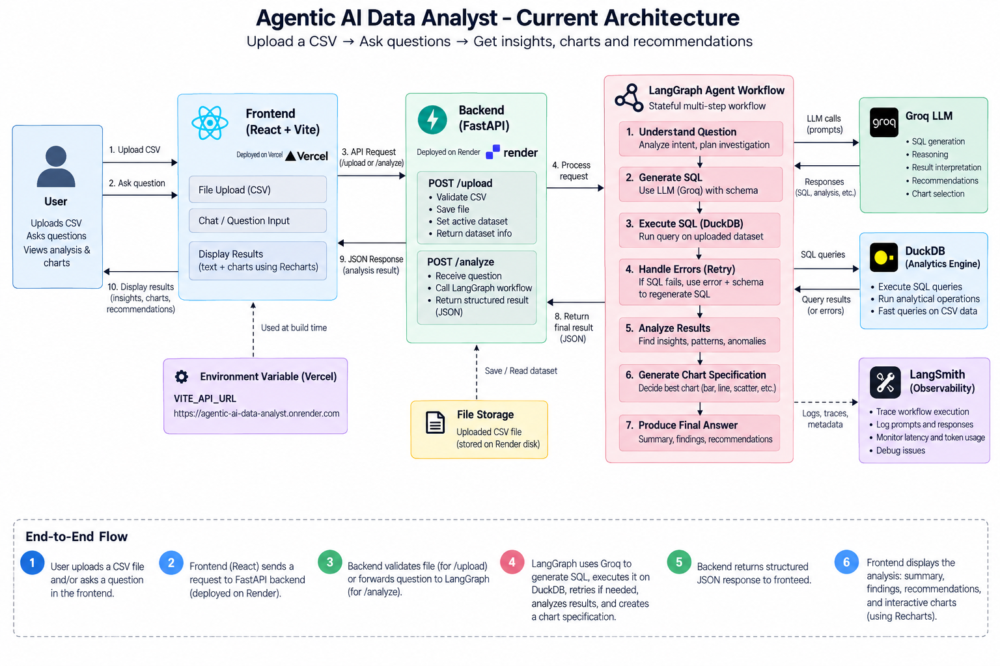

# Agentic AI Data Analyst (DataWise AI)

An enterprise-ready, agentic AI Data Analyst application that allows users to upload one or more CSV files and interact with their data using natural language. Built with **LangGraph**, **DuckDB**, **FastAPI**, **Groq LLM**, and **React + Recharts**.

The application goes beyond simple prompt-wrapping: it plans investigations, deterministically executes SQL in an in-memory database, heals its own SQL errors, renders dynamic charts, detects statistical anomalies, generates equivalent Pandas code, explains its reasoning, and maintains conversational context throughout the session.

---

## Live Deployments

- **Frontend App:** [https://agentic-ai-data-analyst.vercel.app/](https://agentic-ai-data-analyst.vercel.app/)
- **Backend API:** [https://agentic-ai-data-analyst.onrender.com](https://agentic-ai-data-analyst.onrender.com)
- **API Health Check:** [https://agentic-ai-data-analyst.onrender.com/health](https://agentic-ai-data-analyst.onrender.com/health)

---

## Architecture Diagram



### LangGraph Agent State Machine

```text
User Question + Session Context
              ↓
    [ Inspect Dataset Schema ]
              ↓
  [ Validate Question Guardrail ]
        ├─ Invalid → [ Out-of-Scope Answer Node ] → END
        └─ Valid
              ↓
  [ Plan Analytical Investigation ]
              ↓
    [ Generate DuckDB SQL ]
              ↓
    [ Execute SQL via DuckDB ]
        ├─ SQL Error? → [ Fix SQL Node ] ──(Retry Loop ≤ 2)──→ [ Execute SQL ]
        └─ Success
              ↓
    [ Analyze Observations ]
        ├─ Needs 2nd Query? ──(≤ 2 queries)──→ [ Generate SQL ]
        └─ Complete
              ↓
    [ Final Analysis & ChartSpec ]
              ↓
[ Answer Synthesis (Findings + Evidence + Code + Anomalies) ]
              ↓
             END
```

---

## Core Principles & Responsibility Separation

| Component | Technology | Responsibility |
| :--- | :--- | :--- |
| **Orchestration** | **LangGraph** | Multi-node state machine, self-healing retry cycles, error handling |
| **Reasoning** | **Groq (GPT-OSS-120B / LLaMA)** | Question planning, schema comprehension, insight synthesis, code generation |
| **Computation** | **DuckDB** | Deterministic in-memory SQL execution, aggregation, statistical outlier scans |
| **API Backend** | **FastAPI** | File uploads, input validation, session management, REST endpoints |
| **Presentation** | **React + Vite** | Modern analytics dashboard, interactive code viewer, session memory chips |
| **Visualization**| **Recharts** | Declarative rendering driven by backend `ChartSpec` contracts |
| **Observability**| **LangSmith** | Full-run execution tracing, node latency monitoring, token accounting |

### Why DuckDB + LLM Separation?
Large Language Models are probabilistic and prone to arithmetic hallucinations when aggregating thousands of rows. Our system enforces a strict separation:
- **LLM = Reasoning & Orchestration** (plans what to compute and explains results)
- **DuckDB = Computation** (executes deterministic math, aggregations, and statistics in microseconds)
- **Workflow:** `CSV → DuckDB → Compact Result Subset → LLM → Structured Insights & Reasoning`

---

## Key Features

### 1. CSV Upload & Schema Validation
- Supports arbitrary CSV files up to 50MB.
- Automatic schema discovery using DuckDB's `read_csv_auto`.
- Generates data quality reports (null value distribution, duplicate row counts, data types).

### 2. Natural Language Answering
- Direct conversational querying of tabular business data.
- Domain-agnostic: Works across sales, e-commerce, healthcare, finance, or marketing datasets without hardcoded schema assumptions.
- Out-of-scope guardrails that gracefully reject non-data questions without wasting LLM tokens on SQL generation.

### 3. Business Insights & Evidence
- Responses are delivered in a structured executive format:
  - **Summary:** Concise executive briefing.
  - **Key Findings:** Numbered, prioritized factual insights.
  - **Evidence:** Concrete numerical facts, ratios, and percentages cited directly from DuckDB.
  - **Recommendations:** Actionable strategic next steps grounded in the data.

### 4. Dynamic Visualizations (`ChartSpec`)
- Backend dynamically returns a strongly-typed `ChartSpec`:
  ```json
  {
    "type": "bar",
    "title": "Total Sales by Region",
    "x_axis": "Region",
    "y_axis": "total_sales",
    "data": [{"Region": "West", "total_sales": 725450}, ...]
  }
  ```
- Supports **Bar**, **Line**, **Pie**, **Scatter**, and **Histogram** charts via Recharts. Selects `"none"` automatically when a scalar or non-visual answer is appropriate.

### 5. SQL & Pandas Code Generation
- Exposes the exact **DuckDB SQL query** executed against the database.
- Generates the equivalent **Python Pandas code** (assuming `df = pd.read_csv(...)`) to allow data teams to reproduce results locally.
- Integrated dark-themed code viewer with tabbed toggles (`SQL (DuckDB)` / `Pandas (Python)`) and one-click clipboard copying.

### 6. Statistical Anomaly & Outlier Detection
- Automated statistical anomaly detection engine using deterministic DuckDB queries:
  - **Z-Score Outlier Analysis:** Flags records deviating $> 2.5\sigma$ from the column mean.
  - **Interquartile Range (IQR):** Identifies values falling outside $[Q_1 - 1.5\text{IQR}, Q_3 + 1.5\text{IQR}]$.
- Surfaces structured anomaly cards in the UI detailing the **Metric**, **Flagged Value**, **Expected Range**, **Severity** (`HIGH`, `MEDIUM`, `LOW`), and a natural language explanation of **why the value was flagged**.

### 7. Transparent AI Reasoning & Methodology
- Expandable **AI Reasoning & Methodology** drawer revealing the internal analytical process:
  - **Step 1 (Investigation Plan):** The strategic breakdown and hypothesis formulated by the agent.
  - **Step 2 (Analytical Deduction):** Detailed step-by-step reasoning explaining how the numbers support the findings and why specific recommendations were given.

### 8. Multi-Turn Session Memory & Conversation Context
- In-memory `SessionManager` tracks conversation history across query turns.
- Resolves pronoun references (*"Show its monthly trends"*, *"Why did that happen?"*, *"Generate SQL for this analysis"*).
- Interactive sidebar session tracker displaying turn history with one-click re-prompting and a `↻ New Session` reset button.

### 9. Self-Healing SQL Retry Loop
- Probabilistic SQL generation errors are caught by DuckDB.
- Errors, previous queries, and schemas are fed back to a `fix_sql` node, recovering automatically without crashing the user session.

### 10. Evaluation Framework
- Automated test suite ([`Backend/app/evaluation/evaluator.py`](file:///Backend/app/evaluation/evaluator.py)) with 12 benchmark test cases evaluating:
  - Question Relevance / Guardrail accuracy
  - Pass@1 & Pass@2 (Self-Healing Recovery)
  - Semantic Ground-Truth SQL matching
  - Chart Selection Accuracy
  - Numerical Faithfulness / Hallucination Detection

---

## Tech Stack

- **Backend:** Python 3.10+, FastAPI, Uvicorn, DuckDB, Pandas, Pydantic v2
- **Agent Framework:** LangGraph, LangChain Core, LangChain Groq
- **LLM Engine:** Groq API (`openai/gpt-oss-120b`)
- **Observability:** LangSmith
- **Frontend:** React 19, Vite, Recharts, CSS3
- **Hosting:** Vercel (Frontend), Render (Backend)

---

## Project Structure

```text
Agentic-AI-Data-Analyst/
├── README.md                      # Project documentation
├── docker-compose.yml             # Multi-container orchestration (Backend + Frontend)
├── image.png                      # Architecture diagram
├── sample_datasets/               # Curated benchmark datasets for testing
│   ├── README.md                  # Dataset descriptions & sample questions
│   ├── sales.csv                  # Primary retail sales benchmark
│   ├── retail_sales_dataset.csv   # Retail demographics & transaction data
│   └── ecommerce_sales_data.csv   # Extended e-commerce dataset
├── Backend/
│   ├── Dockerfile                 # Backend container definition
│   ├── requirements.txt           # Python backend dependencies
│   ├── .env                       # Environment variables (API keys)
│   ├── data/
│   │   └── sales.csv              # Primary benchmark sales dataset
│   ├── uploads/                   # Uploaded user datasets
│   └── app/
│       ├── main.py                # FastAPI endpoints & application routes
│       ├── agent/
│       │   └── graph.py           # LangGraph state machine & agent nodes
│       ├── services/
│       │   ├── database.py        # DuckDB connection & statistical engine
│       │   └── session_store.py   # Multi-turn conversation memory store
│       ├── tool/
│       │   ├── data_tool.py       # Dataset inspection tool
│       │   └── sql_tool.py        # Read-only SQL execution tool
│       └── evaluation/
│           ├── test_cases.py      # 12 benchmark test cases
│           ├── evaluator.py       # Automated evaluation harness
│           └── reports/           # Generated evaluation markdown reports
└── frontend/
    └── Frontend/
        ├── Dockerfile             # Frontend container definition (Nginx)
        ├── package.json           # Node.js dependencies
        ├── vite.config.js         # Vite configuration
        ├── index.html             # Entry HTML
        └── src/
            ├── App.jsx            # Main dashboard component
            ├── App.css            # Dark analytics design system
            ├── Graph.jsx          # Recharts visualization renderer
            └── main.jsx           # React root
```

---

## Setup & Installation

### Option A: Docker Compose (Preferred / One-Command Setup)

For reviewers with Docker installed:

1. **Set your Groq API key** in `Backend/.env` (or pass it in your shell):
   ```bash
   export GROQ_API_KEY=your_groq_api_key_here
   ```

2. **Build and launch both services:**
   ```bash
   docker compose up --build
   ```
   - **Frontend:** `http://localhost:5173`
   - **Backend API:** `http://localhost:8000` (Docs: `http://localhost:8000/docs`)

---

### Option B: Local Setup (Without Docker)

#### 1. Prerequisites
- Python 3.10 or higher
- Node.js 18 or higher (with npm)
- Groq API Key ([https://console.groq.com/](https://console.groq.com/))
- *(Optional)* LangSmith API Key for tracing ([https://smith.langchain.com/](https://smith.langchain.com/))

---

#### 2. Backend Setup

1. **Navigate to the Backend directory:**
   ```bash
   cd Backend
   ```

2. **Create and activate a virtual environment:**
   ```bash
   # Windows (PowerShell)
   python -m venv .venv
   .\.venv\Scripts\Activate.ps1

   # Linux / macOS
   python3 -m venv .venv
   source .venv/bin/activate
   ```

3. **Install dependencies:**
   ```bash
   pip install -r requirements.txt
   ```

4. **Configure environment variables:**
   Create or edit `Backend/.env`:
   ```env
   GROQ_API_KEY=your_groq_api_key_here

   # Optional LangSmith Tracing
   LANGSMITH_TRACING=true
   LANGSMITH_API_KEY=your_langsmith_key_here
   LANGSMITH_PROJECT=AI-Data-Analyst
   ```

5. **Start the FastAPI backend:**
   ```bash
   uvicorn app.main:app --host 127.0.0.1 --port 8000 --reload
   ```
   The backend will be live at `http://127.0.0.1:8000`.

---

#### 3. Frontend Setup

1. **Navigate to the Frontend directory:**
   ```bash
   cd frontend/Frontend
   ```

2. **Install dependencies:**
   ```bash
   npm install
   ```

3. **Configure API URL:**
   Create or edit `frontend/Frontend/.env`:
   ```env
   VITE_API_URL=http://127.0.0.1:8000
   ```

4. **Start the Vite development server:**
   ```bash
   npm run dev
   ```
   Open `http://localhost:5173` in your browser.

---

## Running the Evaluation Framework

To run the automated evaluation harness against the benchmark sales dataset:

```bash
cd Backend
python -m app.evaluation.evaluator
```

The harness will execute all 12 test cases, perform semantic result comparisons against ground truth queries, verify chart selection, check numerical faithfulness, and write an executive scorecard to `app/evaluation/reports/evaluation_report.md`.

---

## Sample Datasets & Example Questions

Sample datasets are organized in the [`sample_datasets/`](file:///sample_datasets/) directory:
- `sample_datasets/sales.csv` — Multi-region retail transactions with Dates, Categories, Products, Sales, Quantity, and Profit.
- `sample_datasets/retail_sales_dataset.csv` — Retail customer demographic and transaction dataset.
- `sample_datasets/ecommerce_sales_data.csv` — Multi-category volume e-commerce data.

### Example Questions to Try:
- **Aggregation:** *"What are the total sales per region?"*
- **Ranking:** *"Which region generated the highest revenue?"*
- **Time-Series Trend:** *"Show monthly sales trends."*
- **Underperforming Assets:** *"Which products are underperforming in profit?"*
- **Customer Analysis:** *"What are the top five customers by revenue?"*
- **Code Generation:** *"Generate SQL for this analysis."*
- **Anomaly Detection:** *"Detect anomalies in the dataset."*
- **Follow-up Turn:** *"Show its trends over time."* (referencing the previous answer)

---

## Security & Implementation Notes

1. **Read-Only SQL Execution Guard:** The SQL tool strictly permits `SELECT` statements and blocks modifying keywords (`DROP`, `DELETE`, `UPDATE`, `INSERT`, `ALTER`, `TRUNCATE`, `CREATE`).
2. **Deterministic Computations:** All numerical totals, averages, and outlier bounds are calculated directly by DuckDB; the LLM never fabricates raw statistics.
3. **Session-Level Context:** Conversation context is managed through memory sessions identified by a unique `session_id`, isolating dialogue threads across users.
4. **CORS:** FastAPI CORS middleware is pre-configured for local (`http://localhost:5173`) and production (`https://agentic-ai-data-analyst.vercel.app`) origins.
