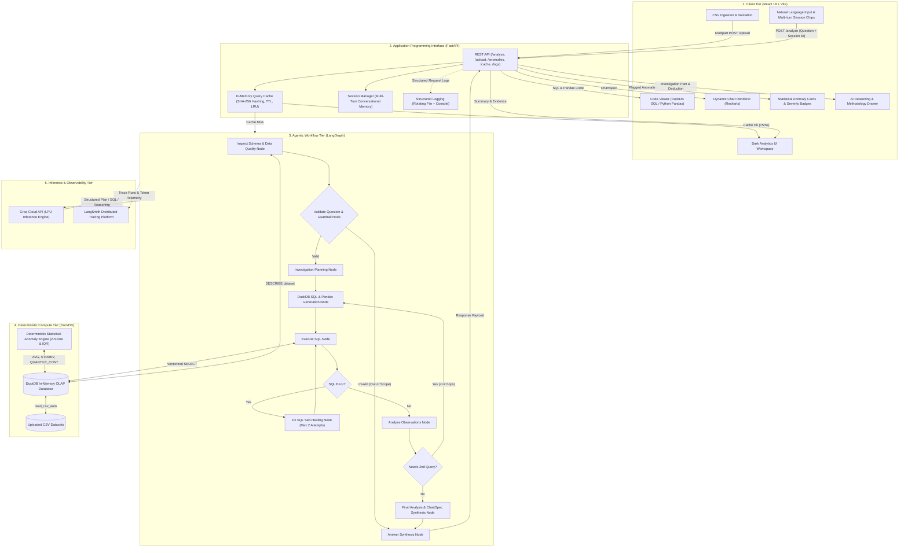

# Technical Documentation: Agentic AI Data Analyst (DataWise AI)

## 1. Executive Summary & System Philosophy

**DataWise AI** is a production-grade agentic data intelligence system engineered to eliminate the fundamental flaw of naive LLM data analysis: **numerical hallucination**. 

Standard text-generation models cannot compute large aggregations, standard deviations, or percentages accurately. DataWise AI solves this through a **strict separation of responsibilities**:
- **Deterministic Computation (DuckDB):** All data transformations, filtering, aggregations, percentages, and statistical outlier scans are calculated directly by DuckDB's in-memory columnar OLAP engine.
- **Probabilistic Reasoning (Groq LPU + Open-Source LLMs):** The language model plans investigations, generates syntax-compliant SQL/Pandas code, reasons over computed facts, and synthesizes executive business insights.
- **Cognitive Orchestration (LangGraph):** Manages dynamic state transitions, guardrail validations, multi-hop investigations, and self-healing SQL retry loops.

```
┌────────────────────────────────────────────────────────────────────────┐
│                        DATAWISE ARCHITECTURAL SPLIT                    │
├──────────────────────────────────┬─────────────────────────────────────┤
│   PROBABILISTIC REASONING (LLM)  │    DETERMINISTIC COMPUTE (DUCKDB)   │
├──────────────────────────────────┼─────────────────────────────────────┤
│ • Natural Language Understanding │ • Columnar Aggregations (SUM, AVG)  │
│ • Investigation Planning         │ • Exact Floating-Point Arithmetic   │
│ • DuckDB SQL Code Generation     │ • Statistical Outlier Bounds        │
│ • Python Pandas Code Generation  │ • Grouping, Filtering, Joins        │
│ • Executive Briefing & Strategy  │ • Zero-Copy In-Memory Execution     │
└──────────────────────────────────┴─────────────────────────────────────┘
```

---

## 2. System Architecture & Component Design

The system is organized into five decoupled layers:



---

## 3. Ingestion & Deterministic Compute Engine (DuckDB)

### 3.1 Zero-Copy Ingestion
Upon CSV upload (`POST /upload`), the file is staged in `uploads/` and loaded directly into an isolated DuckDB in-memory instance:

```sql
CREATE TABLE dataset AS
SELECT *
FROM read_csv_auto('/absolute/path/to/dataset.csv');
```

- **Type Inference:** DuckDB's `read_csv_auto` automatically infers dates (`DATE`, `TIMESTAMP`), numbers (`BIGINT`, `DOUBLE`), and categories (`VARCHAR`).
- **Isolation:** DuckDB operates entirely in RAM (`:memory:`), providing zero network round-trip overhead and sub-millisecond execution.

### 3.2 SQL Execution Security Sandbox
All generated queries are routed through a strict read-only execution guard ([`Backend/app/tool/sql_tool.py`](Backend/app/tool/sql_tool.py)):
1. **Mutation Blocking:** Scans query text for write/schema mutation keywords (`DROP`, `DELETE`, `UPDATE`, `INSERT`, `ALTER`, `TRUNCATE`, `CREATE`). Any matching query is immediately aborted.
2. **Context Window Protection:** Output DataFrames are capped at **25 rows** and **4,000 characters maximum**. If a query returns 5,000 rows, the top 25 rows are formatted alongside a total row count note (`[NOTE: Truncated to top 25 rows for agent context out of 5000 total rows returned]`). This prevents token inflation and eliminates Groq TPM 413 errors.
3. **Regex Sanitization:** Before execution, queries pass through `clean_sql()`, which strips conversational text, markdown fences, and isolates pure `SELECT` or `WITH` queries.

---

## 4. LangGraph Cognitive State Machine

The analysis pipeline is built as a compiled `StateGraph` with 9 specialized nodes, 2 conditional routers, and persistent state tracking.

### 4.1 State Schema (`AgentState`)
```python
class AgentState(TypedDict):
    question: str
    question_valid: bool
    session_id: str
    conversation_history: str
    schema: str
    data_quality: str
    sql_query: str
    pandas_code: str
    anomalies: list[dict]
    reasoning: str
    query_result: str
    error: str
    sql_attempts: int
    investigation_plan: str
    observations: str
    query_count: int
    needs_second_investigation: bool
    summary: str
    findings: list[str]
    evidence: list[str]
    recommendations: list[str]
    chart: dict
    final_answer: str
```

### 4.2 State Machine Graph Specification

```
[ START ]
    │
    ▼
[ inspect ] ─────────► Queries DuckDB schema, row count, nulls, and statistical scan
    │
    ▼
[ validate ] ────────► Structured LLM check (QuestionCheck: valid=bool)
    │
    ├─► (Invalid) ────► [ answer ] (Returns out-of-scope guidance) ──► [ END ]
    │
    ▼ (Valid)
[ plan ] ────────────► Generates concise 2-step investigation plan
    │
    ▼
[ generate_sql ] ────► Synthesizes DuckDB SQL + Pandas code
    │
    ▼
[ execute_sql ] ─────► Deterministic execution in DuckDB
    │
    ├─► (SQL Error & attempts < 2) ──► [ fix_sql ] ──► [ execute_sql ] (Self-Healing Loop)
    ├─► (SQL Error & attempts >= 2) ─► [ failure ] ──► [ END ]
    │
    ▼ (Success)
[ analyze ] ─────────► Extracts factual observations + decides if multi-hop query needed
    │
    ├─► (needs_second=True & query_count < 2) ──► [ generate_sql ] (Multi-Hop Iteration)
    │
    ▼
[ final_analysis ] ──► JSON Mode LLM enforces Pydantic FinalResult schema
    │
    ▼
[ answer ] ──────────► Formats executive output + records turn in session history
    │
    ▼
  [ END ]
```

### 4.3 Node Specifications

| Node | Input State | Output State | Responsibility |
| :--- | :--- | :--- | :--- |
| `inspect` | `dataset` | `schema`, `data_quality` | Extracts column types and generates token-efficient quality brief. |
| `validate` | `question`, `conversation_history` | `question_valid` | Guardrail rejecting out-of-scope non-data questions. |
| `plan` | `question`, `schema`, `history` | `investigation_plan` | Outlines the exact metrics, dimensions, and comparisons needed. |
| `generate_sql`| `plan`, `schema`, `observations` | `sql_query`, `sql_attempts` | Generates read-only DuckDB SQL without reserved keyword collisions. |
| `execute_sql` | `sql_query` | `query_result`, `error` | Executes SQL on DuckDB, enforcing row and character caps. |
| `fix_sql` | `sql_query`, `error`, `schema` | `sql_query` | Self-healing node correcting SQL syntax, aliases, or column names. |
| `analyze` | `query_result`, `question` | `observations`, `needs_second` | Distills raw rows into concise facts and checks if 2nd query is needed. |
| `final_analysis`| `observations`, `query_result` | `FinalResult` (JSON) | Structured generation of summary, findings, evidence, chart, code, reasoning. |
| `answer` | `FinalResult`, `state` | `final_answer` | Formats final response payload for UI consumption. |
| `failure` | `error`, `sql_attempts` | `summary`, `final_answer` | Graceful degradation node when SQL cannot be recovered. |

---

## 5. Statistical Anomaly & Outlier Detection Engine

The anomaly detection engine ([`Backend/app/services/database.py`](Backend/app/services/database.py)) identifies statistical outliers deterministically inside DuckDB using two industry-standard methodologies:

### 5.1 Z-Score Outlier Detection ($> 2.5\sigma$)
For all numeric columns ($X$), DuckDB computes the mean ($\mu$) and sample standard deviation ($\sigma$):

$$\mu = \frac{1}{N} \sum_{i=1}^{N} x_i, \quad \sigma = \sqrt{\frac{1}{N-1} \sum_{i=1}^{N} (x_i - \mu)^2}$$

Records satisfying the condition below are flagged as outliers:

$$|x_i - \mu| > 2.5\sigma$$

The normal expected range is established as:

$$[\mu - 2.5\sigma, \;\mu + 2.5\sigma]$$

### 5.2 Interquartile Range (IQR) Analysis
To prevent extreme skewness from distorting the standard deviation, DuckDB calculates the first and third quartiles:

$$\text{IQR} = Q_3 - Q_1 = \text{QUANTILE\_CONT}(X, 0.75) - \text{QUANTILE\_CONT}(X, 0.25)$$

Values falling outside the Tukey fences are flagged:

$$x_i < Q_1 - 1.5 \times \text{IQR} \quad \text{or} \quad x_i > Q_3 + 1.5 \times \text{IQR}$$

### 5.3 Automated Severity Classification & Reasoning
Each flagged anomaly is classified into a structured `AnomalyItem`:
- **`HIGH` Severity:** Deviation exceeds $4.0\sigma$ or falls $> 3.0 \times \text{IQR}$ outside quartiles.
- **`MEDIUM` Severity:** Deviation between $2.5\sigma$ and $4.0\sigma$.
- **`LOW` Severity:** Mild deviation ($1.5 \times \text{IQR}$ border).
- **Reason Explanation:** An automated plain-language sentence explaining *why* the record was flagged (e.g., *"Value \$18,500.00 is 3.82 standard deviations above the mean of \$1,420.50"*).

---

## 6. Multi-Turn Session Memory & Conversational Context

Conversational continuity is handled by the `SessionManager` ([`Backend/app/services/session_store.py`](Backend/app/services/session_store.py)).

### 6.1 Session Turn Schema
```python
{
    "turn": 1,
    "timestamp": 1730822400.0,
    "question": "Which region generated the highest revenue?",
    "summary": "West region led all sales with $725,450...",
    "sql_query": "SELECT Region, SUM(Sales) ...",
    "findings": ["West generated 38.2% of total revenue."],
    "evidence": ["West Sales: $725,450.00"]
}
```

### 6.2 Pronoun & Reference Resolution
When follow-up questions are submitted (e.g., *"Show its monthly trends"*, *"Why did that happen?"*, *"Generate SQL for this analysis"*), `SessionManager.format_history_for_prompt()` injects prior turns directly into:
1. `validate_question_node`: Prevents guardrails from rejecting conversational pronouns as "out-of-scope".
2. `planning_node`: Disambiguates references to previously identified entities (e.g., *its* = *West region*).
3. `sql_generation_node`: Reuses filters, dimensions, and metrics from prior conversation turns.

---

## 7. In-Memory Query Caching (`QueryCache`)

The caching service ([`Backend/app/services/cache_service.py`](Backend/app/services/cache_service.py)) eliminates redundant LLM calls and DuckDB compute for recurring questions.

### 7.1 Deterministic Key Normalization
Questions are sanitized to prevent cache misses due to superficial punctuation or case differences:
1. Strip leading/trailing whitespaces.
2. Convert text to lowercase.
3. Remove trailing punctuation (`?`, `.`, `!`).
4. Collapse multiple spaces into a single space.
5. Generate a SHA-256 hash:

$$\text{Key} = \text{SHA256}(\text{dataset\_id} \parallel ":" \parallel \text{normalized\_question})$$

### 7.2 Performance & Invalidation Policy
- **Cache Hit Latency:** `< 5ms` (bypasses LangGraph and Groq entirely).
- **TTL Expiration:** Default 3,600 seconds (1 hour).
- **LRU Eviction:** When entries reach capacity (`max_entries = 200`), the oldest entry by `cached_at` timestamp is pruned.
- **Reactive Invalidation:** Whenever a new CSV is uploaded via `POST /upload`, `query_cache.clear()` is called immediately to prevent stale analytics.

---

## 8. Structured Logging & Observability

Observability is maintained through dual mechanisms:

### 8.1 Structured Local Logging (`logger_service.py`)
- Writes to both `stdout` and a rotating file at `Backend/logs/analyst.log` (5MB maximum size, 3 backup archives).
- Tagged lifecycle events:
  - `[REQUEST]` — Inbound question, session ID, active dataset.
  - `[CACHE HIT]` / `[CACHE MISS]` — Cache resolution speed and hit counter.
  - `[UPLOAD SUCCESS]` — File size, row count, and column count.
  - `[ANALYSIS SUCCESS]` — Pipeline latency, chart type selected, SQL character length.
  - `[AGENT ERROR]` — Pipeline exceptions and self-healing recovery triggers.

### 8.2 LangSmith Distributed Tracing
Full execution traces (including token counts, prompt templates, tool calls, and model latency) are streamed in real time to the LangSmith cloud platform under the project `AI-Data-Analyst`.

---

## 9. Dynamic Visualizations (`ChartSpec`)

The agent dynamically outputs a strongly typed `ChartSpec` rendered on the frontend via Recharts:

```typescript
interface ChartSpec {
  type: "line" | "bar" | "pie" | "histogram" | "scatter" | "none";
  title: str;
  x_axis: string | null;
  y_axis: string | null;
  data: Array<Record<string, any>>;
}
```

### Chart Selection Heuristics
- **Bar:** Categorical comparisons (e.g., Sales by Region, Volume by Category).
- **Line:** Time-series trends (e.g., Monthly Sales across 2023–2024).
- **Pie:** Part-to-whole proportions and percentage shares.
- **Scatter:** Correlation between two continuous variables (e.g., Discount vs. Profit).
- **Histogram:** Frequency distribution of a single numeric metric.
- **None:** Scalar answers, lists, or questions unsuitable for graphical representation.

---

## 10. REST API Specification

### Endpoints Overview

| Method | Endpoint | Description | Request Body / Params | Response |
| :--- | :--- | :--- | :--- | :--- |
| `POST` | `/upload` | Upload & ingest CSV | `multipart/form-data` (`file`) | `UploadResponse` |
| `POST` | `/analyze` | Execute analytical query | `{"question": str, "session_id": str?}` | `AnalyzeResponse` |
| `GET` | `/anomalies` | Scan active dataset for outliers | None | `AnomalyReport` |
| `GET` | `/cache/stats`| Query cache metrics | None | `CacheStats` |
| `POST` | `/cache/clear`| Flush analytical cache | None | `{"status": "cleared"}` |
| `GET` | `/logs` | Retrieve recent server logs | `lines: int = 50` | `{"logs": list[str]}` |
| `POST` | `/session/clear` | Reset multi-turn session | `{"session_id": str}` | `{"status": "cleared"}` |
| `GET` | `/session/{id}/history` | Fetch turn dialogue history | None | `{"history": list[dict]}` |
| `GET` | `/health` | API health check & cache telemetry | None | `{"status": "ok"}` |

### Detailed `/analyze` Response Payload Schema
```json
{
  "session_id": "session_abc123",
  "cached": false,
  "latency_ms": 3420.5,
  "summary": "Executive brief of findings...",
  "findings": [
    "1. West Region generated highest revenue ($725,450).",
    "2. Technology category drove 54% of total profit margin."
  ],
  "evidence": [
    "West total revenue: $725,450.00 vs East: $450,200.00",
    "Profit margin ratio: 0.28"
  ],
  "recommendations": [
    "Reallocate regional marketing spend toward West region Technology segment.",
    "Investigate Office Supplies inventory holding costs in South region."
  ],
  "chart": {
    "type": "bar",
    "title": "Revenue by Region",
    "x_axis": "Region",
    "y_axis": "total_sales",
    "data": [
      {"Region": "West", "total_sales": 725450},
      {"Region": "East", "total_sales": 450200}
    ]
  },
  "sql_query": "SELECT Region, SUM(Sales) AS total_sales FROM dataset GROUP BY Region ORDER BY total_sales DESC;",
  "pandas_code": "df.groupby('Region')['Sales'].sum().reset_index().sort_values(by='Sales', ascending=False)",
  "anomalies": [
    {
      "metric": "Sales",
      "value": "18500.00",
      "expected_range": "0.00 to 4520.10",
      "severity": "high",
      "reason": "Value is 3.82 standard deviations above the mean sales figure."
    }
  ],
  "reasoning": "Step 1: Identified total sales aggregated by geographic dimension...\nStep 2: Cross-verified margins...",
  "investigation_plan": "1. Aggregate sales by region.\n2. Calculate percentage contribution."
}
```

---

## 11. Automated Evaluation Harness & Benchmark Suite

The evaluation suite ([`Backend/app/evaluation/evaluator.py`](Backend/app/evaluation/evaluator.py)) executes 12 benchmark test cases against `sample_datasets/sales.csv`:

### Benchmark Evaluation Dimensions
1. **Question Relevance / Guardrail Accuracy:** Validates that out-of-scope queries (e.g. *"What is the capital of France?"*) are rejected without running SQL.
2. **Pass@1 Rate:** Percentage of analytical queries answered on the first SQL execution attempt.
3. **Pass@2 (Self-Healing Recovery Rate):** Percentage of queries successfully recovered by `fix_sql_node` after an initial DuckDB error.
4. **Semantic Ground-Truth SQL Matching:** Executes the generated SQL alongside a pre-authored ground-truth query and verifies identical tabular results.
5. **Chart Selection Accuracy:** Checks whether the chosen chart type (`bar`, `line`, `pie`, `none`) matches the analytical intent.
6. **Numerical Faithfulness (Hallucination Test):** Verifies that all numbers cited in `findings` and `evidence` exist in the executed DuckDB output.

To run the evaluation harness:
```bash
cd Backend
python -m app.evaluation.evaluator
```

---

## 12. Deployment & Containerization

### Docker Compose (Unified Environment)
The project includes a root [`docker-compose.yml`](docker-compose.yml) orchestrating two isolated containers:
- **`backend` service:** Python 3.11-slim, installing DuckDB, FastAPI, LangGraph, and Uvicorn. Exposes port `8000`.
- **`frontend` service:** Node 18 multi-stage build producing static assets served via Nginx. Exposes port `5173`.

### Production Cloud Architecture
- **Frontend:** Hosted on **Vercel** with automatic global CDN edge caching.
- **Backend:** Hosted on **Render** (Docker runtime) with automatic Git deployments from the `main` branch.
